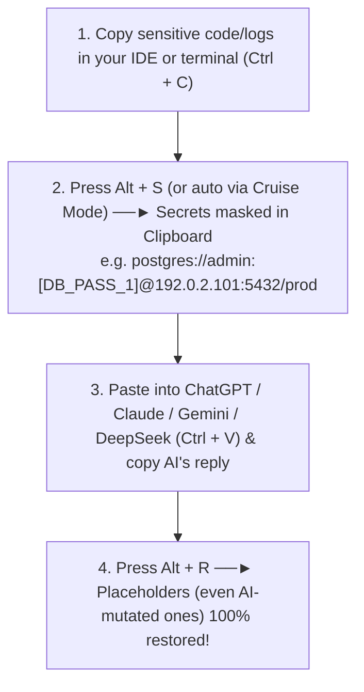

<div align="center">

# 🛡️ AI Privacy Sanitizer `v0.3.1`

**Local Processing · In-Memory Vault by Default · Zero Network Requests · Visual GUI Control Center · Lossless Bidirectional Clipboard & CLI Sanitizer for LLMs**

[](LICENSE)
[](https://www.python.org/)
[](#)
[](#security-commitment)

[**English**](README.md) | [**简体中文**](README.zh-CN.md)

</div>

---

## 💡 Why AI Privacy Sanitizer?

When debugging production incidents, reviewing code, or analyzing server logs with cloud LLMs (**ChatGPT, Claude, DeepSeek, Gemini, Cursor**), pasting raw text directly from your terminal or IDE can easily leak:
- 🔑 **API Keys & Cloud Tokens** (`sk-...`, `sk_live_...`, `ghp_...`, `AKIA...`, `AIza...`, `xoxb-...`, `gsk_...`, `hf_...`, `npm_...`, `pypi-...`, `dop_v1_...`, `lin_api_...`, `sbp_...`, `PMAK-...`, `shpat_...`, Azure SAS `sig=...`, JWTs, Bearer tokens, Slack/Discord/Feishu/DingTalk/WeCom Webhook URLs)
- 🗄️ **Database & Auth Secrets** (`postgres://`, `mysql://`, `mongodb://`, `redis://`, ODBC connection strings, `.env` variables, `curl -u` credentials)
- 📜 **PEM / SSH Private Keys** (`-----BEGIN RSA/OPENSSH PRIVATE KEY-----`)
- 💻 **System File Path Usernames** (`C:\Users\<username>\...`, `/Users/<username>/...`, `/home/<username>/...` — masks only the personal OS username while preserving path structure)
- 🌐 **Internal Infrastructure** (Private IPv4 `10.x.x.x` / `192.168.x.x` / `172.16-31.x.x`, Public IPv4, IPv6, MAC addresses)
- 🪪 **Personal Identifiable Information (PII)** (Emails, International & Malaysian `+60` phone numbers, Malaysian MyKad NRIC with state PB-code validation, Mainland China 18-digit ID, Passports, Luhn-validated Bank Cards)
- 🏢 **Proprietary Business Entities** (Company names, Client names, Internal project codenames)

**AI Privacy Sanitizer** runs in your system tray and sanitizes clipboard text via global hotkeys (`Alt+S` to sanitize, `Alt+R` to restore) or best-effort **Cruise Mode**. Session mappings use RAM by default; explicitly enabling CLI `--vault-file` persists original secrets as plaintext. Custom dictionaries and exported configurations are also stored locally.

---

## ✨ Key Features

### 1. 🖥️ Zero-Setup Visual GUI Control Center (`src/gui.py`)
- **🏠 Dashboard & Instant Toggles**: Monitor session interception stats and toggle **Auto-Sanitize on Copy (Cruise Mode)**, **Semantic Disguise Mode (`192.0.2.x` / `user1@example.com` / `dev_user_1`)**, **Windows Startup**, **Dark/Light Themes**, and **English/Chinese UI** with a single click. Includes **⏪ Undo Last Sanitize** (retains up to 5 recent raw clipboard snapshots in RAM).
- **⌨️ Custom Global Hotkey Recorder**: Easily rebind `Alt+S` / `Alt+R` to any key combination using presets or live keypress recording.
- **🧪 Live Interactive Sandbox**: Paste raw logs on the left and preview sanitized output with green highlighted placeholders and **per-category interception pills** (`API_KEY: 6 | DB_PASS: 5`) in real time on the right.
- **📚 Optional Custom Dictionary + Allowlist & Built-in Rule Toggles**:
  - Organize proprietary terms under `COMPANY`, `CLIENT`, `PROJECT`, and `CUSTOM_SECRET` with batch import/export and an **in-app JSON editor** (never forces open external IDEs).
  - Switch to the **🛡️ Allowlist & Built-in Rule Switches** panel to add safe strings that bypass sanitization or enable/disable individual built-in regex rules.
- **🔐 Live RAM Session Vault with Anti-Shoulder-Surfing Mask**: Inspect active `Placeholder <-> Original Value` mappings in memory. Defaults to **masked preview (`sk-pro***O678`)** during screen sharing/recording, with a one-click **👁️ Reveal/Mask Originals** toggle.

### 2. 🧠 Two-Layer Precision Sanitization Engine (`src/sanitizer.py` & `src/rules.py`)
- **Layer 1 — Custom Dictionary (Longest-Match-First)**: Matches custom company, client, and project names from longest to shortest (case-insensitive) so short aliases never truncate full legal names (e.g., `"Acme Global Technologies Sdn Bhd"` is matched before `"Acme Global"`).
- **Layer 2 — 35+ High-Precision Built-in Regex Detectors + Algorithmic Validators**:
  - **Algorithmic Checksum Validators**: Built-in `luhn_checksum_valid` prevents 16-digit timestamps/order numbers from false-matching as bank cards; `my_nric_valid` validates Malaysian birth dates and official State/Country PB codes.
  - **Structure-Preserving Masking**: Masks only the secret portion in database URIs, Basic Auth URLs, OS file paths, and key-value assignments (`postgres://dbadmin:[DB_PASS_1]@[PRIVATE_IP_1]:5432/prod`).
  - **English & Chinese Natural Key-Value Support**: Supports `password = "..."`, `pass = ...`, `pw = ...`, `id = ...`, `密码-123123`, `账号=asdasd`, `户口=...`.
  - **Two-Stage Exact + Fuzzy/Case-Insensitive Restore**: Even if an LLM alters `<API_KEY_1>` into `[API_KEY_1]`, `` `API_KEY_1` ``, `<api_key_1>`, `{API_KEY_1}`, or `&lt;API_KEY_1&gt;`, `restore()` accurately recovers the original secret.

### 3. 🌐 Semantic Disguise Mode (RFC 5737 & Synthetic Entities)
- When troubleshooting Nginx, firewall, or Kubernetes network configs, replacing IPs with `[PRIVATE_IP_1]` can cause LLMs to complain about invalid syntax.
- Enabling **Semantic Disguise Mode** replaces real private IPs (`10.52.18.9`) with RFC 5737 test IPs (`192.0.2.101`), public IPs with `203.0.113.101`, emails with `user1@example.com`, and OS path usernames with `dev_user_1` — while `Alt+R` restores the supported placeholders locally.

### 4. 🛡️ Single-Instance Guard, Developer CLI Pipes & Zero-Storage Web Edition
- **Kernel-Level Single-Instance Protection (`src/startup.py`)**: Uses Windows Named Mutex & Events (zero network ports). Double-clicking the `.exe` when already running in the tray wakes up the existing Control Center window or hot-replaces the process if upgraded.
- **Developer Terminal CLI Pipeline (`src/main.py`)**: Pipe logs directly in terminal workflows via `--stdin`, `--restore-stdin`, `--file <in>`, and `--output <out>`.
- **Standalone RAM-Only Web Edition (`web/index.html`)**: A zero-dependency single HTML file running 100% in browser RAM (zero `localStorage`, zero cookies, zero network requests, 10-minute auto-wipe idle timer, **🔍 Highlighted Diff Preview with hover tooltips**, Vault secret masking, and RAM Allowlist).

---

## 🔄 3-Second Daily Workflow



---

## 🚀 Getting Started

### Option 1: Standalone Windows Executable (Recommended for Users)
1. Prefer the EXE from a tagged GitHub Release and verify its `SHA256SUMS` and `build-info.json` when available. The repository-root EXE is a historical binary; source edits do not update it, and its provenance has not been verified by this change.
2. On first launch, the **Visual Control Center** opens automatically and places a blue shield-lock icon in your Windows system tray.
3. Closing the window (`X`) minimizes it safely to the system tray. Left-click the tray icon or double-click the `.exe` anytime to reopen the Control Center.

Windows EXE settings are stored privately in `%LOCALAPPDATA%\Sanitizer\config.json`, outside the executable directory. On first launch, an existing adjacent `config.json` is copied there without changing its contents or deleting the original; an existing local configuration takes precedence. Source runs and explicitly supplied config paths retain their existing behavior. This keeps active settings out of synced project folders, whose temporary upload hardlinks would otherwise trigger the private-file checks.

### Option 2: Run from Source / CLI Pipeline / Build `.exe` (For Developers)

```powershell
# 1. Create virtual environment and install dependencies
python -m venv .venv
.\.venv\Scripts\Activate.ps1
pip install -r requirements.txt

# 2. Run the focused tests relevant to your change (no screenshots required)
python -m pytest -q tests/test_security_boundaries.py -k 'oversize or private'
node tests/test_web_security.cjs

# 3. Developer CLI Pipeline usage (stdin / file sanitization)
Get-Content app.log | python -m src.main --stdin > app.sanitized.log
python -m src.main --file .env.production --output .env.sanitized

# 4. Launch the desktop app from source
python -m src.main

# 5. Export multi-resolution icon & package standalone .exe
python -m src.main --export-ico assets/icon.ico
pyinstaller --noconfirm AI-Privacy-Sanitizer.spec
```

### Option 3: Pure In-Memory Web Edition
Open [`web/index.html`](web/index.html) directly in any modern browser (or upload it as a single file to Hostinger / GitHub Pages / Cloudflare Pages). All sanitization and restoration run 100% inside JavaScript volatile variables.


### Option 4: Experimental macOS `.app` / `.dmg` (macOS 15+)

The Windows `.exe` cannot run natively on macOS. Native macOS packaging is experimental: no `.app` or `.dmg` has been built or verified from these changes yet. A Mac is not required to request a build: once the workflow is available on the repository's default branch, open **Actions → Experimental macOS Build → Run workflow**, and select `arm64` (Apple Silicon) or `x86_64` (Intel). Each run builds only the selected architecture on its matching macOS runner.

A successful run saves an app ZIP, a DMG containing the app and an Applications shortcut, `build-info.json`, and `SHA256SUMS` as a seven-day Actions artifact. It does **not** publish a GitHub Release. The app includes Python and dependencies; recipients do not need Python installed. To install a verified build, copy the `.app` from the DMG to Applications.

The workflow checks bundle identity, native architecture, ad-hoc signing integrity, a packaged CLI self-test with synthetic temporary settings, and DMG integrity. It does not test GUI appearance, menu-bar interaction, clipboard permissions, sleep/wake or real hardware behavior. The bundle is ad-hoc signed and **not Apple-notarized**; Gatekeeper may block it. Building does not require an Apple Developer account; trusted public distribution with Developer ID/notarization is a separate future step.

In this preview, global hotkeys are disabled because the current keyboard backend requires administrator execution on macOS. Use GUI or menu-bar actions; do not run the app as root. Windows startup registration and the Windows single-instance mechanism do not apply to macOS. Settings are stored privately at `~/Library/Application Support/AI-Privacy-Sanitizer/config.json`, outside the app bundle.

For a native developer build on a matching Mac/Python architecture:

```bash
python3.11 -m venv .venv
source .venv/bin/activate
python -m pip install --require-hashes -r requirements-macos-lock.txt
python scripts/build_macos.py --arch arm64  # use x86_64 on an Intel Mac
```

Outputs are written under `dist/macos/<architecture>/`. Linux/Windows hosts and mismatched architectures are rejected. Source inputs and checksums are recorded, but real Mac user acceptance remains required before calling this a stable macOS release.

---

## ⌨️ Hotkeys & System Tray Guide

| Action | Default Hotkey | System Tray Menu Item | Description |
| :--- | :--- | :--- | :--- |
| **Open Control Center** | Left-click Tray Icon | `🖥️ Open Control Center` | Manage custom words, Allowlist, rule switches, Sandbox, and Vault |
| **Sanitize Clipboard** | `Alt + S` | `1. Sanitize Clipboard` | Replace sensitive clipboard strings with safe placeholders + Toast summary |
| **Restore Clipboard** | `Alt + R` | `2. Restore Clipboard` | Recover original values from exact or AI-mutated placeholders |
| **Undo Last Sanitize** | Button in UI / Tray | `⏪ Undo Last Sanitize` | Restore the pre-sanitized raw clipboard content (up to 5 snapshots) |
| **Cruise Mode** | Toggle in UI / Tray | `⚡ Auto-Sanitize on Copy` | Best-effort polling about every 0.55s; review the result before pasting |
| **Windows Startup** | Toggle in UI / Tray | `🚀 Launch at Startup` | Start silently in the system tray when logging into Windows |
| **Clear Session Vault** | Button in UI / Tray | `4. Clear Session Map` | Immediately wipe all in-memory placeholder mappings and undo snapshots |
| **Exit Application** | Button in UI / Tray | `5. Exit` | Unhook global hotkeys and terminate the tray process cleanly |

---

## 📂 Project Structure

```text
ai-privacy-sanitizer/
├── .github/workflows/
│   └── ci-build.yml         # Automated multi-OS pytest & Windows EXE release workflow
├── src/
│   ├── __init__.py          # Package version metadata (v0.3.0)
│   ├── main.py              # System tray controller, hotkeys, undo stack, CLI pipes
│   ├── gui.py               # CustomTkinter Dark/Light bilingual GUI Control Center
│   ├── i18n.py              # English & Simplified Chinese localization strings
│   ├── sanitizer.py         # Two-layer engine, Allowlist, fuzzy restore & SessionVault
│   ├── rules.py             # 35+ compiled regex detectors + Luhn & MyKad NRIC validators
│   └── startup.py           # Windows HKCU Run startup & kernel-level SingleInstanceGuard
├── tests/
│   └── test_sanitizer.py    # Focused core, CLI, GUI-state and Web regression tests
├── web/
│   └── index.html           # 100% RAM-Only standalone Web Edition (zero storage/network)
├── config.example.json      # Safe template configuration file
├── requirements.txt         # Python dependencies
├── README.md                # English documentation
└── README.zh-CN.md          # Simplified Chinese documentation
```

---

## 🔒 Security Commitment

1. **100% Local Execution**: Zero telemetry, zero analytics, zero outbound HTTP/Socket connections, and zero external LLM/API calls.
2. **Default RAM Vault, Explicit Plaintext Persistence**: Desktop session mappings remain in process memory by default. CLI `--vault-file` opts into plaintext JSON containing original values. `config.json`, dictionary exports, restored output and the system clipboard can also contain sensitive data. Clearing or exiting releases application references; it does not guarantee forensic erasure from RAM, swap, crash dumps, clipboard history or backups.
3. **Private File Creation**: Vault/config/export files use private staging files and atomic publication. POSIX files use mode `0600`; Windows uses a protected DACL for the current user before writing any sensitive bytes. A permission or save failure aborts, with no direct-write fallback. Linked paths, junctions, hard-linked files and nonregular destinations are rejected. Use a trusted private directory; ACLs cannot prevent an administrator, same-user malware, backup tools or cloud sync from reading plaintext. Filesystems without the required protections fail closed.
4. **Git and Backup Hygiene**: `.gitignore` covers conventional local filenames; it cannot protect arbitrary exports, files outside the repository, forced additions or already tracked files. Never commit or share vaults/dictionary backups, or place them in shared/synced folders. Existing plaintext vaults remain readable in the same JSON format. Resave to a trusted private path to apply the new protections; remove old copies and unwanted backups, and rotate credentials if a copy was exposed. This does not add encryption or claim secure deletion.
5. **Size, Detection and Clipboard Limits**: Desktop/CLI sanitization rejects input above 1,500,000 characters; CLI exits with status `2` and no processed-text output. The sandbox clears stale output. Clipboard rejection leaves the original **unsanitized** text in place and displays a warning (Cruise notifications are rate-limited). Cruise Mode polls about every 0.55s and cannot guarantee completion before another app pastes. Writes recheck the source on every retry, but pyperclip has no cross-application atomic compare-and-swap; a small OS race remains. For sensitive material, use the sandbox/manual action and inspect the result before sharing. Pattern matching can miss secrets or mask ordinary data; it does not guarantee complete detection.
6. **Intentional Restoration**: Restore only in a local, explicit action. AI output is untrusted: a valid mapped tag can recover a real secret even if the surrounding text is malicious. Review restored text before sharing. Fuzzy restore accepts paired supported delimiters and known IDs; semantic values match complete tokens. After 150 distinct IPs per semantic category, further IPs use bracketed tags to keep allocation bounded and restoration lossless. Web diff tooltips follow the Vault Reveal/Mask toggle and hide full originals by default.

Web session clearing (manual or after idle timeout) also removes custom words, allowlist entries, pending drafts and rendered originals, and resets Reveal to masked. Pending clipboard reads are invalidated; clipboard writes check for intervening changes and report success only after completion. Imported vaults must contain consistent, recognized mappings; invalid or conflicting files are rejected without changing the active session. Existing valid JSON exports remain supported.

### Safe CLI files and opt-in restoration

```powershell
python -m src.main --file input.log --output sanitized.log
# Replacing an existing output requires explicit consent; input/output aliases are always rejected.
python -m src.main --file input.log --output sanitized.log --overwrite
# PLAINTEXT mappings: choose a private path outside Git and cloud sync.
Get-Content input.log | python -m src.main --stdin --vault-file private-mapping.local.json
Get-Content reply.txt | python -m src.main --restore-stdin --vault-file private-mapping.local.json
```

Input, output, vault and configuration paths must be distinct, including aliases. Shell redirection can itself truncate an existing file before Python starts; prefer `--file`/`--output` when file preservation matters. Vault and output publication are separate file operations, not a multi-file transaction.

### Release inputs and provenance

CI and Windows releases install exact direct/transitive versions and upstream artifact SHA-256 hashes from `requirements-lock.txt` using `python -m pip install --require-hashes -r requirements-lock.txt`. `requirements-macos-lock.txt` extends these shared pins with hashed macOS build dependencies; `requirements.txt` keeps source-install compatibility ranges. To update, resolve deliberately in a clean Python 3.11 environment, include Windows-only dependencies, verify the hashes against PyPI, and run only the affected focused checks. Actions use full upstream commit SHAs; review the upstream change before updating each SHA/comment.

Only the tag-push release job receives `contents: write`; PR and test jobs use read access. Future releases include source commit/run metadata and asset checksums. These checksums detect changed downloads; they are not code signing or a guarantee of bit-identical builds across runner images. Do not treat the checked-in EXE as a build of your current working tree.

---

## 📄 License

Released under the [MIT License](LICENSE).
