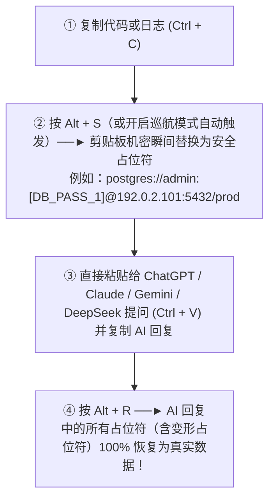

<div align="center">

# 🛡️ AI Privacy Sanitizer (AI 隐私脱敏卫士) `v0.3.1`

**本地处理 · 默认内存映射 · 零外部网络请求 · 可视化 GUI 控制中心 · 双向无损还原的系统剪贴板与 CLI 脱敏工具**

[](LICENSE)
[](https://www.python.org/)
[](#)
[](#安全承诺-security-commitment)

[**English**](README.md) | [**简体中文**](README.zh-CN.md)

</div>

---

## 💡 为什么需要 AI Privacy Sanitizer？

在日常使用 **ChatGPT、Claude、DeepSeek、Gemini、Cursor** 等大模型排查生产故障、分析日志或重构代码时，直接从终端或 IDE 复制粘贴极易泄露高危机密：
- 🔑 **API 密钥与云凭证** (`sk-...`, `sk_live_...`, `ghp_...`, `AKIA...`, `AIza...`, `xoxb-...`, `gsk_...`, `hf_...`, `npm_...`, `pypi-...`, `dop_v1_...`, `lin_api_...`, `sbp_...`, `PMAK-...`, `shpat_...`, Azure SAS `sig=...`, JWT, Bearer Token, 飞书/钉钉/企微/Slack/Discord Webhook)
- 🗄️ **数据库连接串与密码** (`postgres://`, `mysql://`, `mongodb://`, `redis://`, ODBC 连接串, `.env` 环境变量, `curl -u` 账号密码)
- 📜 **多行私钥证书块** (`-----BEGIN RSA/OPENSSH PRIVATE KEY-----`)
- 💻 **本地文件路径中的真实系统用户名** (`C:\Users\<username>\...`、`/Users/<username>/...`、`/home/<username>/...`，仅脱敏个人系统用户名段并完整保留路径结构)
- 🌐 **内网与网络基础设施** (内网 IPv4 `10.x.x.x` / `192.168.x.x` / `172.16-31.x.x`、公网 IPv4、IPv6、MAC 地址)
- 🪪 **个人身份与隐私信息 (PII)** (电子邮箱、马来西亚 `+60`/`01x` 及中国大陆/国际手机号、带州属代码校验的大马身份证 MyKad NRIC、中国 18 位身份证、护照号、带 Luhn 校验的银行卡号)
- 🏢 **商业机密实体** (公司全称/简称 `Sdn Bhd`、客户名称、内部项目代号)

**AI Privacy Sanitizer** 常驻于系统托盘，无需复杂配置，通过全局快捷键一键完成**剪贴板双层脱敏 (`Alt+S`)**、**复制即自动脱敏（巡航模式）**与 **AI 回复占位符 受支持格式的容错还原 (`Alt+R`)**。默认会话映射保存在本地内存（RAM）中；CLI 主动启用 `--vault-file` 后会明文保存原值。自定义词典与配置导出也会写入本地文件。

---

## ✨ 核心特性

### 1. 🖥️ 零门槛可视化 GUI 控制中心 (`src/gui.py`)
- **🏠 首页总览与即时开关**：直观展示本次会话拦截统计，支持一键切换 **复制即自动脱敏（懒人巡航模式）**、**全类别语义伪装模式 (`192.0.2.x` / `user1@example.com` / `dev_user_1`)**、**开机自动启动**、**深色/浅色主题** 与 **中英双语界面**。内置 **⏪ 撤销脱敏 (Undo)** 按钮（纯内存保留最近 5 次脱敏前快照）。
- **⌨️ 全局快捷键自由录制**：若默认 `Alt+S` / `Alt+R` 与其他软件冲突，可直接下拉选择或点击“🎯 录制按键”自定义任意组合键，保存即刻生效。
- **🧪 实时脱敏测试沙盒**：左侧输入或粘贴原始代码/日志，右侧实时预览脱敏效果（绿色高亮标记被保护的占位符），顶部实时展示**按类别统计的彩色胶囊标签**（如 `API_KEY: 6 | DB_PASS: 5`）。
- **📚 选填专属词典 + 白名单与内置规则开关**：
  - 按 `COMPANY`（公司）、`CLIENT`（客户）、`PROJECT`（项目）、`CUSTOM_SECRET`（机密）分类管理词条，支持逗号批量添加、导入/导出备份，并内置语法校验 JSON 编辑器（绝不强行跳转外部编辑器）。
  - 支持切换至 **“🛡️ 白名单 (Allowlist) 与内置规则开关”** 子面板，自由添加免脱敏白名单或按需启用/禁用任意内置正则规则。
- **🔐 内存映射保险箱 (`SessionVault`) 与防窥屏遮罩**：实时检索当前会话内存中保存的 `占位符 <-> 真实敏感值` 对应关系；默认将原始敏感值打星号遮罩（如 `sk-pro***O678`），点击 **“👁️ 显示/遮罩原始敏感值”** 才明文显示，防止共享屏幕或录屏时意外泄密。

### 2. 🧠 双层高强度脱敏与容错还原引擎 (`src/sanitizer.py` & `src/rules.py`)
- **第一层：个人高危词典（按词长从长到短优先匹配）**：忽略大小写，严格优先匹配长词条（例如先匹配 `"Acme Global Technologies Sdn Bhd"`，再匹配 `"Acme Global"`），防止短词截断长词。
- **第二层：35+ 项内置高强度正则规则库 + 算法级校验器**：
  - **Luhn 与大马 NRIC 校验器**：内置 `luhn_checksum_valid` 彻底消除 16 位时间戳/订单号误报为银行卡的问题；内置 `my_nric_valid` 严格校验出生月日与马来西亚合法州属代码（PB Code）。
  - **保留结构脱敏**：精准识别数据库连接串、URL Basic Auth、操作系统文件路径与代码赋值语句，仅替换密码、Token 或用户名部分（如 `postgres://dbadmin:[DB_PASS_1]@[PRIVATE_IP_1]:5432/prod`），完美保留代码语法结构。
  - **中英文自然语言键值兼容**：全面支持 `password = "..."`、`pass = ...`、`pw = ...`、`id = ...` 以及中文日常表达（如 `密码-123123`、`登录密码 是 xxx`、`账号=asdasd`、`户口=...`）。
  - **两阶段容错逆向还原 (Fuzzy & Case-Insensitive Restore)**：即使大模型在回复中将 `<API_KEY_1>` 改写为 `[API_KEY_1]`、`` `API_KEY_1` ``、`<api_key_1>`、`{API_KEY_1}` 或 HTML 实体 `&lt;API_KEY_1&gt;`，`restore()` 可识别并还原受支持的格式。

### 3. 🌐 全类别语义伪装模式 (RFC 5737 & 语义实体)
- 在让 AI 排查防火墙、Nginx 或集群网络配置时，如果将 IP 替换为 `[PRIVATE_IP_1]`，部分模型可能会报格式语法错误。
- 开启 **语义伪装模式** 后，真实内网 IP（如 `10.52.18.9`）伪装为 RFC 5737 标准测试 IP（`192.0.2.101`），公网 IP 伪装为 `203.0.113.101`，邮箱伪装为 `user1@example.com`，路径用户名伪装为 `dev_user_1`；按 `Alt+R` 时依然能 **逆向还原**回原始真实值！

### 4. 🛡️ 内核级防多开热替换 + 终端 CLI 管道 + 纯前端零残留 Web 版
- **单实例防多开与自动唤醒 (`src/startup.py`)**：基于 Windows 内核命名互斥锁（Mutex）与事件对象（Event），零网络端口占用。程序在后台托盘运行时，再次双击 `.exe` 会直接唤醒已有控制中心窗口；若检测到 `.exe` 版本更新，会自动通知旧进程退出并无缝完成热替换。
- **开发者终端 CLI 管道模式 (`src/main.py`)**：支持 `--stdin`、`--restore-stdin`、`--file <path>` 与 `--output <path>`，可直接嵌入终端管道流批处理脱敏日志文件。
- **100% 纯内存 Web 版 (`web/index.html`)**：单文件零依赖网页版，所有脱敏与还原均在浏览器当前标签页的 JS 内存变量中完成，**绝不写入 `localStorage` / Cookie，零网络请求，内置 10 分钟闲置自动清空倒计时、🔍 差异高亮悬停预览 (Diff Preview)、保险箱防窥遮罩与纯内存白名单**，关闭或刷新页面即彻底销毁。

---

## 🔄 3 秒极简日常工作流



---

## 🚀 快速开始

### 方式一：直接双击独立 `.exe` 运行（推荐普通用户）
1. 建议使用带标签的 GitHub Release 产物，并核对可用的 `SHA256SUMS` 与 `build-info.json`。仓库根目录的 EXE 是历史二进制，本次源码修改不会更新它，也未验证其构建来源。
2. 首次启动会自动弹出**可视化控制中心窗口**，并在右下角系统托盘生成蓝色盾牌锁图标。
3. 点击窗口右上角 `X` 会自动最小化常驻到右下角系统托盘；左键点击托盘图标或再次双击 `.exe` 即可随时唤出控制中心。

Windows EXE 的运行配置私有保存在 `%LOCALAPPDATA%\Sanitizer\config.json`，与 EXE 目录分开。首次启动会将 EXE 旁已有的 `config.json` 原样复制过去，保留原文件；如果本机配置已经存在，则优先使用它。源码运行及显式指定配置路径的行为保持不变。这样可以避开同步目录上传时产生的临时硬链接，继续保留私有文件安全检查。

### 方式二：从源码运行 / 终端 CLI 管道 / 打包 `.exe`（开发者）

```powershell
# 1. 创建并激活虚拟环境，安装依赖
python -m venv .venv
.\.venv\Scripts\Activate.ps1
pip install -r requirements.txt

# 2. 仅运行与改动相关的定向测试（无需截图）
python -m pytest -q tests/test_security_boundaries.py -k 'oversize or private'
node tests/test_web_security.cjs

# 3. 开发者终端 CLI 管道脱敏用法
Get-Content app.log | python -m src.main --stdin > app.sanitized.log
python -m src.main --file .env.production --output .env.sanitized

# 4. 从源码启动桌面程序
python -m src.main

# 5. 导出多分辨率盾牌图标并打包单文件无黑框 .exe
python -m src.main --export-ico assets/icon.ico
pyinstaller --noconfirm AI-Privacy-Sanitizer.spec
```

### 方式三：使用 Web 纯内存版
直接用任意浏览器打开 [`web/index.html`](web/index.html)（或单文件上传至 Hostinger / GitHub Pages / Cloudflare Pages），无需安装任何环境即可在浏览器内存中安全脱敏与还原。


### 方式四：实验性 macOS `.app` / `.dmg`（macOS 15 及以上）

Windows 的 `.exe` 无法在 macOS 原生运行。这里新增的是实验性原生打包支持：本次修改尚未实际构建或验证 `.app` / `.dmg`。没有 Mac 也能请求构建：工作流进入仓库默认分支后，在 **Actions → Experimental macOS Build → Run workflow** 选择 `arm64`（Apple Silicon）或 `x86_64`（Intel）。每次只在对应的 macOS runner 上构建所选架构。

成功后会保存 `.app` 的 ZIP、包含应用及 Applications 快捷方式的 DMG、`build-info.json` 和 `SHA256SUMS`，作为保留七天的 Actions 构建附件；**不会自动发布 GitHub Release**。应用包含 Python 和依赖，使用者无需安装 Python。核验构建后，可把 DMG 内的 `.app` 拖入 Applications 安装。

工作流会检查应用标识、原生架构、临时签名完整性、使用合成数据与独立临时配置的打包后 CLI 自检，以及 DMG 完整性。不验证界面外观、菜单栏交互、剪贴板权限、休眠唤醒或真实硬件体验。产物采用 ad-hoc 临时签名，**没有 Apple 公证**，可能被 Gatekeeper 阻止。构建不需要 Apple Developer 账号；用于公开可信分发的 Developer ID 签名与公证是后续独立工作。

本实验版暂不启用全局快捷键，因为当前键盘后端在 macOS 要求管理员运行。请使用界面或菜单栏按钮，不要以 root 运行应用。Windows 开机自启和 Windows 单实例机制不适用于 macOS。配置私有保存于 `~/Library/Application Support/AI-Privacy-Sanitizer/config.json`，不会写入 `.app` 内部。

在架构匹配的 Mac/Python 环境中也可本地构建：

```bash
python3.11 -m venv .venv
source .venv/bin/activate
python -m pip install --require-hashes -r requirements-macos-lock.txt
python scripts/build_macos.py --arch arm64  # Intel Mac 使用 x86_64
```

产物位于 `dist/macos/<architecture>/`。脚本拒绝 Linux/Windows 主机及架构不匹配的构建，记录源码输入信息和校验和。在称为稳定 macOS 发行版之前，仍需真实 Mac 用户验收。

---

## ⌨️ 快捷键与托盘菜单指南

| 操作 | 默认快捷键 | 托盘右键菜单项 | 功能说明 |
| :--- | :--- | :--- | :--- |
| **打开控制中心** | 左键点击托盘图标 | `🖥️ 打开可视化控制中心` | 图形化增删敏感词、白名单与规则开关、沙盒测试、查看内存映射表 |
| **一键脱敏** | `Alt + S` | `1. 立即脱敏剪贴板` | 将剪贴板敏感内容替换为安全占位符并弹出拦截统计通知 |
| **一键还原** | `Alt + R` | `2. 立即还原剪贴板` | 将 AI 回复中的占位符或伪装值 按受支持格式恢复为真实数据 |
| **撤销脱敏** | 界面/托盘点击 | `⏪ 撤销上一次脱敏` | 一键恢复最近一次脱敏前的原始剪贴板内容（最多保留 5 次） |
| **自动脱敏巡航** | 界面/托盘勾选 | `⚡ 复制即自动脱敏 (巡航模式)` | 约每 0.55 秒尽力轮询；粘贴前必须检查结果 |
| **开机自动启动** | 界面/托盘勾选 | `🚀 开机自动启动` | 勾选后登录 Windows 时自动静默驻留右下角托盘 |
| **清空内存映射** | 界面/托盘点击 | `4. 清空当前内存映射表` | 立即销毁当前会话内存中的所有映射记录与撤销栈 |
| **完全退出程序** | 界面/托盘点击 | `5. 退出程序 (Exit)` | 卸载全局快捷键并安全退出托盘进程 |

---

## 📂 目录结构

```text
ai-privacy-sanitizer/
├── .github/workflows/
│   └── ci-build.yml         # GitHub Actions 跨平台自动测试与 Windows EXE 自动发布流水线
├── src/
│   ├── __init__.py          # 版本信息定义 (v0.3.0)
│   ├── main.py              # 托盘图标、全局快捷键、撤销栈、巡航监听、CLI 管道与单实例入口
│   ├── gui.py               # CustomTkinter 深浅色中英双语 GUI 控制中心
│   ├── i18n.py              # 简体中文与英文国际化词条库
│   ├── sanitizer.py         # 核心：双层脱敏引擎、白名单、双阶段容错还原与 SessionVault
│   ├── rules.py             # 35+ 项内置高强度正则表达式库 + Luhn/MyKad NRIC 校验器
│   └── startup.py           # Windows 开机自启注册表管理与内核级单实例唤醒/热替换机制
├── tests/
│   └── test_sanitizer.py    # 核心、CLI、GUI 状态与 Web 的定向回归测试
├── web/
│   └── index.html           # 100% 纯浏览器内存运行 Web 版（零 localStorage 落盘）
├── config.example.json      # 公开的【示例】配置文件模板
├── requirements.txt         # Python 依赖库清单
├── README.md                # 英文版项目说明文档
└── README.zh-CN.md          # 简体中文版项目说明文档
```

---

## 🔒 安全承诺 (Security Commitment)

1. **100% 纯本地运行**：无任何遥测、无分析统计、无任何外发 HTTP/Socket 请求，绝不调用任何外部大模型 API。
2. **默认内存映射，可选明文持久化**：桌面会话映射默认仅在进程内存中。CLI 的 `--vault-file` 会主动开启包含真实原值的明文 JSON 保存。`config.json`、词典导出、还原结果和系统剪贴板也可能包含敏感内容。清空或退出会释放应用引用，不保证内存、交换分区、崩溃转储、剪贴板历史或备份中的取证擦除。
3. **私有文件创建**：Vault、配置和导出通过私有临时文件及原子发布保存。POSIX 使用 `0600`，Windows 在写入敏感内容前设置仅允许当前用户访问、禁止继承的 DACL。权限或写入失败会终止，不回退为直接写入。拒绝软链接、junction、硬链接和非普通文件。请使用可信私有目录；ACL 无法阻止管理员、同用户恶意程序、备份或同步工具读取明文。不支持所需保护的文件系统会安全失败。
4. **Git 与备份**：`.gitignore` 只能忽略约定文件名，不能保护任意命名的导出、仓库外文件、强制添加或已跟踪文件。不要提交或公开分享 Vault/词典备份，也不要放入共享或云同步文件夹。旧明文 Vault 保持原 JSON 格式兼容；重新保存至可信私有路径可应用新权限，并清理旧副本与不需要的备份。如曾泄露，应轮换凭证。本次未增加加密，也不承诺安全擦除。
5. **长度、检测与剪贴板边界**：桌面/CLI 脱敏超过 1,500,000 字符时明确拒绝；CLI 返回 `2` 且不输出处理文本，沙盒清空过期结果。剪贴板超限时保留**尚未脱敏的原文**并提示，巡航提示有频率限制。巡航约每 0.55 秒尽力检查，不能保证其他应用粘贴前完成。每次写回重试前核对原文，但 pyperclip 不提供跨应用原子比较写入，因此仍有很小的系统竞争窗口。敏感材料应手动脱敏/使用沙盒并检查后再分享。模式匹配可能漏报、误报，不能保证检出所有秘密。
6. **主动还原**：仅在本地由明确操作触发。AI 回复是不可信文本，即使周边内容恶意，有效映射标签仍会还原真实数据，分享前必须检查。容错还原仅接受配对的受支持括号与已知编号；语义值按完整词元匹配。语义 IP 每类别前 150 个保持原格式，后续改用括号标签，防止循环分配与映射覆盖。Web 差异预览 tooltip 遵循 Vault 的显示/遮罩开关，默认隐藏完整原值。

Web 手动清空会话或闲置自动清理时，也会清除自定义词条、白名单、输入草稿及已渲染原值，并恢复遮罩。尚未完成的剪贴板读取会失效；写回前检查内容是否变化，成功完成后才显示成功提示。导入 Vault 必须包含一致且受支持的映射；无效或冲突文件会被拒绝，不改变当前会话。现有有效 JSON 导出保持兼容。

### 安全输出与可选跨进程恢复

```powershell
python -m src.main --file input.log --output sanitized.log
# 已有输出必须显式允许覆盖；输入/输出的同文件别名始终拒绝。
python -m src.main --file input.log --output sanitized.log --overwrite
# 下列映射为明文，请选择 Git 和云同步范围之外的私有目录。
Get-Content input.log | python -m src.main --stdin --vault-file private-mapping.local.json
Get-Content reply.txt | python -m src.main --restore-stdin --vault-file private-mapping.local.json
```

输入、输出、Vault 和配置必须是不同文件，包含路径别名。Shell 的 `>` 重定向可能在 Python 启动前就清空文件；需要保留原文件时优先使用 `--file`/`--output`。Vault 和输出分别原子保存，不构成多文件事务。

### 构建依赖与发布来源

CI 与 Windows 发行构建使用 `python -m pip install --require-hashes -r requirements-lock.txt`，固定直接/传递依赖的精确版本及 PyPI 产物 SHA-256。`requirements-macos-lock.txt` 在共享版本锁定之上补充带哈希的 macOS 构建依赖；源码安装保留 `requirements.txt` 兼容范围。更新时在干净的 Python 3.11 环境明确解析版本、包含 Windows 专用依赖、对照 PyPI 核验哈希，并只运行相关定向检查。Actions 固定完整上游提交 SHA；更新 SHA 与版本注释前需审阅上游变更。

只有标签 push 的发布 Job 获得 `contents: write`，PR/测试 Job 使用只读权限。后续发布附带源码提交/运行信息和产物校验和；校验和用于检测下载变更，不等同于代码签名或不同 runner 上逐字节可复现构建。仓库内的历史 EXE 不代表当前工作区源码。

---

## 📄 开源协议 (License)

本项目基于 [MIT License](LICENSE) 开源。

